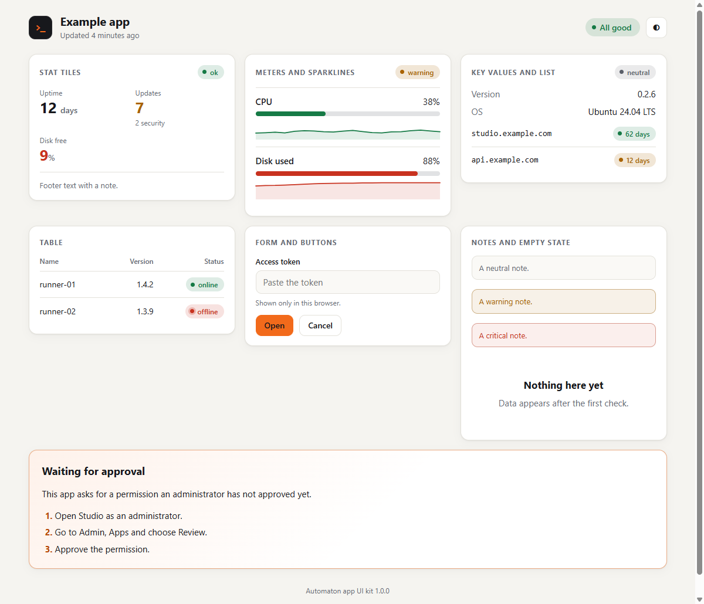
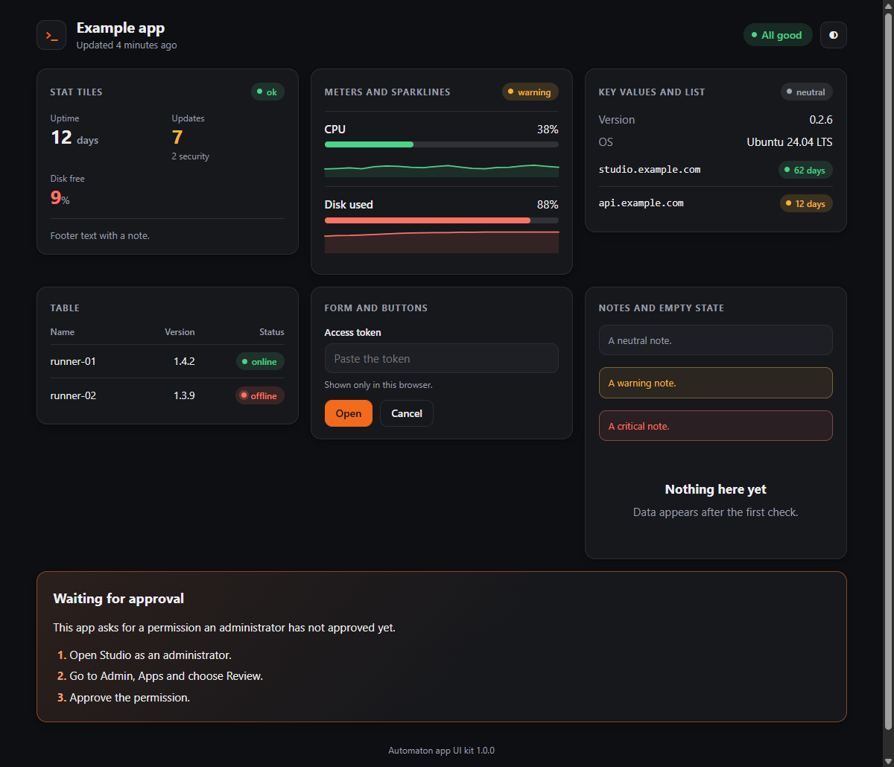

# Automaton app UI kit

One look for every app in this catalog: ink `#17181c`, orange `#f26a1b`, system fonts (no downloads), light and dark from the visitor's system (a toggle is optional), phone-ready. Version **1.0.0**.

| Light | Dark |
| --- | --- |
|  |  |

Open `demo.html` in a browser (it needs nothing else) to see every component.

## Use it in an app

An app is installed from its own folder, so it cannot link to this one. **Copy** the kit files into the app:

```sh
mkdir -p maintenance/my-app/ui
cp design/automaton-app-ui/app.css design/automaton-app-ui/app.js maintenance/my-app/ui/
```

Never edit a copy. To change the look, change the kit here, bump the version in the header comment of both files, and copy again into every app that uses it. CI (`python tools/check_vendored_ui.py`) fails when a copy in any `ui/` folder differs from the kit.

Serve the files from the app and link them:

```html
<link rel="stylesheet" href="ui/app.css">
<script src="ui/app.js"></script>
```

Build the page only from the classes below (all start with `a-`). Add app-specific CSS in the app's own file, never by overriding kit classes. Use the colours through the custom properties (`var(--ok)`, `var(--orange)`, ...), so both themes keep working.

## Components

| Class | Use it for |
| --- | --- |
| `a-page` | The centred page wrapper (max 1120 px, 16 px side gutter). |
| `a-header`, `a-brand`, `a-header__title`, `a-header__sub`, `a-header__actions` | Top of every page: the `>_` mark, app name, one line of context, an overall status pill and the theme button. |
| `a-grid`, `a-grid--wide`, `a-stack` | Responsive columns of cards (one column on a phone); `a-stack` stacks things vertically. |
| `a-card`, `a-card__head`, `a-card__title`, `a-card__foot` | One topic per card. Put a status pill at the right of the head. |
| `a-pill` + `a-pill--ok` / `--warning` / `--critical`, `a-pill--large` | Status. Plain `a-pill` is neutral or unknown. Always write the status in words, never colour alone. |
| `a-stats`, `a-stat` (+ `a-stat--ok/--warning/--critical`), `a-stat__label/__value/__hint` | A few headline numbers. |
| `a-kv` | Label and value rows (`<dl>`). |
| `a-meter` (+ `--warning/--critical`) with `style="--value:42%"` | A percentage of something. |
| `a-metric`, `a-metric__row`, `a-metric__spark` | A named figure with a meter and a trend line. |
| `AutomatonUI.sparkline(values, {min, max, status, label})` | Inline SVG trend (see `app.js`); style it with `a-spark`. |
| `a-table-wrap`, `a-table`, `a-num` | Tables that scroll sideways on a phone instead of breaking the page. |
| `a-list` | Rows with a name on the left and a pill or value on the right. |
| `a-btn`, `a-btn--primary`, `a-btn--icon` | Actions. One primary button per view. |
| `a-form`, `a-field`, `a-label`, `a-input`, `a-hint` | Forms. |
| `a-note` (+ `--warning/--critical`) | A short message inside a card. |
| `a-empty` | Nothing to show yet. |
| `a-waiting`, `a-steps` | "Waiting for approval" and other setup states: say what is missing and numbered steps to fix it. |

## `app.js` (optional)

`AutomatonUI.bindThemeToggle()` wires `[data-theme-toggle]` buttons; `relativeTime`, `updateRelativeTimes` (`<time datetime data-rel>`), `formatBytes`, `formatDuration`, `escapeHtml` and `sparkline` are small helpers. Escape every value you put into `innerHTML`.

## Checking a page

- Light and dark: use the browser's emulation (`agent-browser set media dark`) or the toggle.
- Phone width: 390 px wide, no sideways scrolling, nothing cut off.
- Put a light and a dark screenshot in the pull request.
